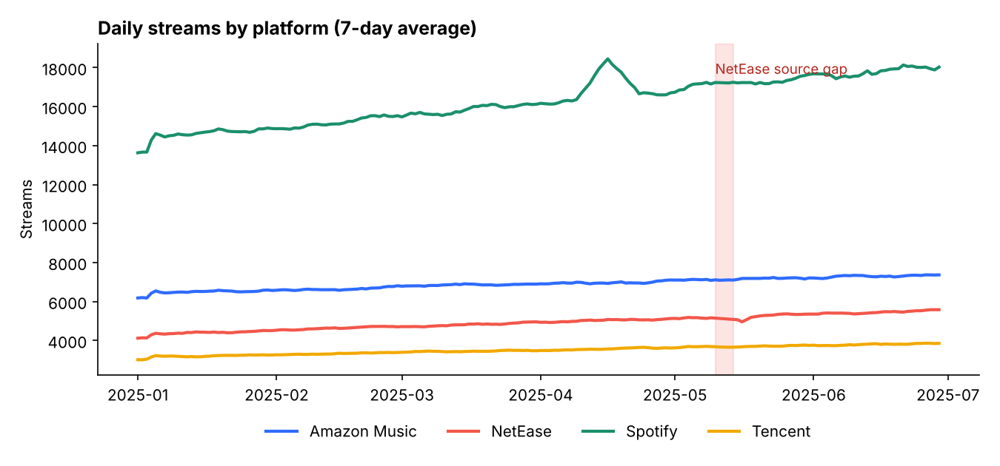
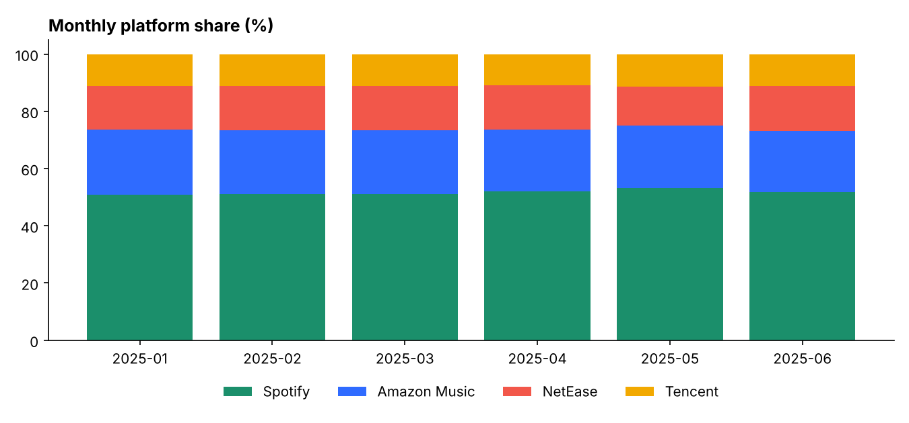
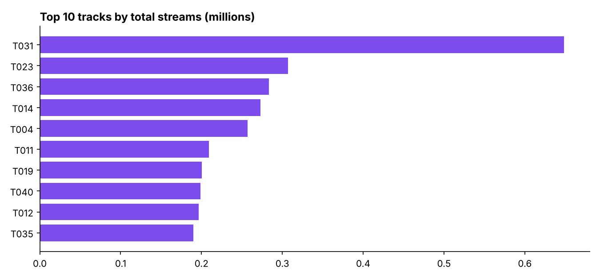

# Streaming Analytics Pipeline

A small, end-to-end analytics project that mirrors how I work day to day: raw platform data goes through SQL staging and mart models, data-quality checks run on it, and the results become charts.

**The data is synthetic.** It is generated with a fixed random seed (`generate_data.py`) so the project is reproducible, and it is not real platform or employer data. I planted known problems in it so the pipeline has something real to catch.

## What it does

```
raw_streams.csv  ->  stg_streams  ->  mart_daily_platform
 (28,640 rows)       (clean)          mart_platform_share
                                      mart_track_summary
                                      mart_anomalies
                          \-> tests/date_gaps.sql
```

| Layer | File | Purpose |
|---|---|---|
| Staging | `models/staging/stg_streams.sql` | Drops null track ids and negative streams, collapses duplicates to one row per day, platform and track |
| Mart | `models/marts/mart_daily_platform.sql` | Daily streams per platform with a 7-day rolling average (window function) |
| Mart | `models/marts/mart_platform_share.sql` | Monthly share of each platform |
| Mart | `models/marts/mart_track_summary.sql` | Track ranking, share of streams and top platform |
| Mart | `models/marts/mart_anomalies.sql` | Flags days above 3x a track's trailing 7-day average |
| Test | `tests/date_gaps.sql` | Finds missing platform-days with a recursive calendar |

The SQL is written the way dbt models are (one `SELECT` per file, built in dependency order). `run_pipeline.py` runs it on SQLite so anyone can run it without a warehouse. Moving it to Snowflake and dbt means swapping the `CREATE TABLE ... AS` wrapper for dbt's materializations, plus small dialect changes such as the date functions.

## Results

**Data quality.** The checks found every planted problem in the raw data: 15 null track ids, 10 negative stream counts and 40 duplicate rows. All three are fixed by staging. The gap test flagged 5 missing days for NetEase (2025-05-10 to 2025-05-14), which staging can't fix. In a real pipeline that would be an alert and a source-side investigation.

**Platform share** across the six months: Spotify 51.7%, Amazon Music 21.9%, NetEase 15.2%, Tencent 11.1%.

**Top track:** T031 with 11.4% of all streams. The top five tracks all lean most on Spotify.

**Anomaly:** track T007 on Spotify jumped to 5.9x its trailing average on 2025-04-10. The check flagged the first two days of a planted seven-day spike. After that the rolling baseline catches up, so a longer-lived spike needs a baseline that excludes flagged days. That is the next improvement.





## Run it

```bash
pip install pandas numpy matplotlib
python generate_data.py
python run_pipeline.py
```

Python 3 and the standard library's `sqlite3` (3.25 or newer, for window functions) are the only other requirements.

## Tools

Python, Pandas, SQL (CTEs, window functions, recursive CTEs), SQLite, Matplotlib
